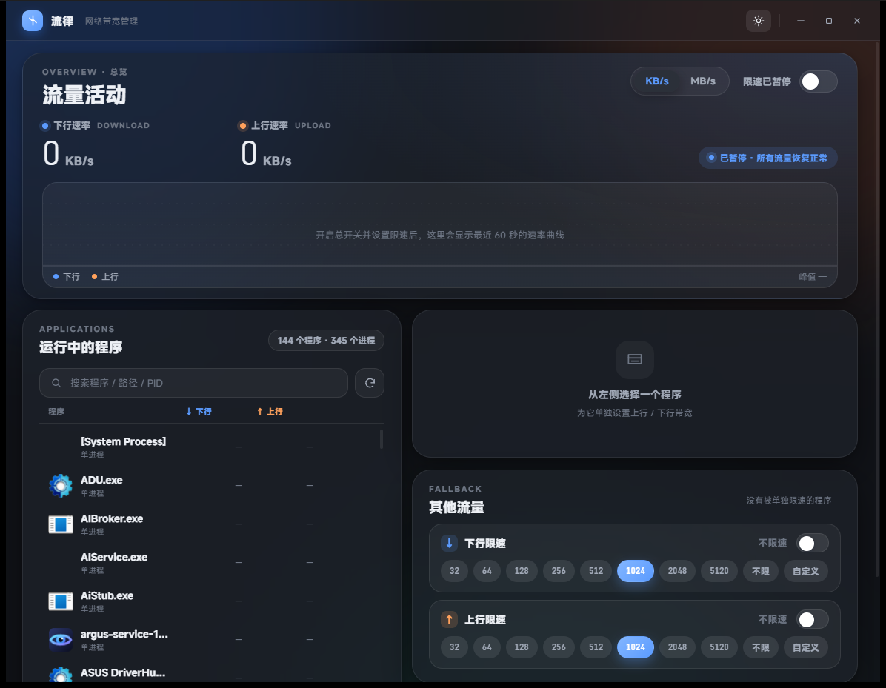

# 流律 (liulv)

> 一个 **Windows 进程级网络带宽限速工具**。为每个程序单独设置上 / 下行速率上限，实时观测流量曲线。
> 后端基于 Rust + [WinDivert](https://www.reqrypt.org/windivert.html) 限速引擎，前端采用 **Tauri 2 + Miuix (HyperOS / MIUI)** 设计语言。

[English](#english) · 许可证：[MIT](#许可证)

---

## ✨ 功能特性

- **进程级限速**：自动发现运行中的程序（名称 + 多进程），为每个程序单独设置下载 / 上传速率上限
- **全局总开关**：一键开启 / 暂停限速，暂停后瞬时恢复满速
- **多种预设挡位**：极慢 / 慢速 / 标准 / 快 / 很快 / 1 兆 / 2 兆 / 5 兆 / 不限，一键切换即时生效
- **自定义速率**：支持任意数值输入，单位 **KB/s** 与 **MB/s** 可切换，并显示 **Mbps** 参考值消除歧义
- **双向独立**：可只限下行、只限上行、或双向分别设置
- **其他流量独立可控**：未被单独限速的流量默认「按原速放行」（不限速）；如需全局限速，可在「其他流量」卡片主动设置
- **实时观测**：超大数字速率显示 + 近 60 秒平滑面积曲线，肉眼验证是否生效
- **真实图标**：列表与详情显示程序真实 exe 图标，无图标的程序只显示名称
- **Miuix 风格界面**：Squircle 大圆角卡片、毛玻璃层次、胶囊开关、分段控件、明暗双主题

## 📸 截图

| 浅色主题 | 深色主题 |
| --- | --- |
|  |  |

## 🏗️ 架构

```
┌──────────────────────────────────────────────────┐
│  Tauri 2 前端（HTML / CSS / Miuix 设计系统）        │
│  自绘标题栏 · 卡片布局 · 明暗主题 · 零 npm 依赖       │
└──────────────────▲─────────────────┬──────────────┘
                   │ Tauri invoke    │ Tauri events
┌──────────────────┴─────────────────▼──────────────┐
│  rl-app（Rust 后端）                                │
│  共享状态 Arc<Mutex>（带超时加锁）· 单后台线程       │
│  配置落盘 config/settings.json                     │
└─────────┬──────────────────────────┬───────────────┘
          │                          │
┌─────────▼──────────┐   ┌───────────▼──────────────┐
│  rl-core            │   │  rl-engine-win            │
│  令牌桶 · 单位换算   │   │  WinDivert 2.2 全局句柄×2 │
│  挡位 · 统计采样     │   │  五元组→PID→令牌桶分派     │
└────────────────────┘   └───────────────────────────┘
```

- **rl-core**：纯逻辑，无平台依赖，可单元测试（单位换算、令牌桶、预设挡位、速率统计）
- **rl-engine-win**：WinDivert 2.2 限速引擎 + `GetExtendedTcpTable/UdpTable` 进程归属映射，
  用户态截包 → 五元组识别进程 → 分派令牌桶 → 重注入 / 丢弃
- **rl-app**：Tauri 2 后端（共享状态 + 单后台线程负责引擎 poll / 进程扫描 / 采样）与 Miuix 前端

## 📁 目录结构

```
liulv-ratelimiter/
├─ Cargo.toml                 # workspace
├─ crates/
│  ├─ rl-core/                # 纯逻辑：单位 / 令牌桶 / 挡位 / 统计
│  ├─ rl-engine-win/src/
│  │  ├─ lib.rs               # 全局句柄 + 五元组分派 + 令牌桶
│  │  └─ proc_map.rs          # 连接表→PID 映射（iphlpapi.dll）
│  └─ rl-app/                 # Tauri 2 后端 + Miuix 前端
│     ├─ frontend/            # index.html / styles.css / app.js（零 npm 依赖）
│     ├─ icons/               # 应用图标
│     ├─ capabilities/        # Tauri 权限
│     └─ src/                 # main.rs + icons.rs + settings.rs
├─ assets/                    # WinDivert.dll / WinDivert64.sys / WebView2Loader.dll
├─ tools/                     # check_filter.py / verify_no_freeze.mjs / verify_ui.py 等
├─ docs/screenshots/          # README 用截图
├─ PLAN.md                    # 开发规划与决策记录
└─ README.md
```

## 🔧 构建

### 前置条件

- Rust 工具链（本项目使用 `stable-x86_64-pc-windows-gnu`；MSVC 也可）
- Windows 10 / 11（**需管理员权限**以加载 WinDivert 驱动）
- WebView2 Runtime（Windows 11 自带；Windows 10 需安装）
- 本机 Git 凭据管理器（GCM）已登录 GitHub

```bash
# 克隆
git clone https://github.com/Gpan666/liulv-ratelimiter.git
cd liulv-ratelimiter

# 构建（GNU 工具链）
export PATH="$HOME/.cargo/bin:$PATH"
cargo build --release --workspace

# 运行（需管理员）
# 构建产物在本机 rl-target/release/rl-app.exe
# 把 dist/ 下的 WinDivert.dll / WinDivert64.sys / WebView2Loader.dll 与 exe 放同目录
# 右键「以管理员身份运行」rl-app.exe
```

> 注：本项目通过 `.cargo/config.toml` 把编译输出目录重定向到纯英文路径，
> 因为 GNU 工具链的 `ld` 无法处理含中文的项目目录。

## 🚀 运行

1. 确保 `rl-app.exe` 与以下文件**同目录**：
   - `WinDivert.dll`、`WinDivert64.sys`（限速驱动，MIT 许可，官方签名）
   - `WebView2Loader.dll`（GNU 工具链下必须随包，否则启动报 `0xC0000135`）
2. **双击 `rl-app.exe` 即可**：普通启动不会强制弹 UAC。若当前不是管理员，窗口顶部会出现橙色「需要管理员权限」横幅，点击「以管理员身份运行」按钮即可**自提权重启**（用 `ShellExecute runas`）；已是管理员则横幅不显示，直接可用。
3. 在左侧选择程序 → 右侧设置上 / 下行限速挡位或自定义速率
4. **点挡位或方向开关即自动开启限速**（无需再手动开总开关）；顶部总开关用于全局暂停。
   ⚠️ 总开关本身**不会**自动限速任何流量——必须选程序或主动设置「其他流量」才会真正接管。
5. 未单独限速、且未在「其他流量」里设置的程序，**原速放行、不被限速**
6. 单位、限速规则、总开关等设置会自动保存（同目录 `config/settings.json`），下次启动恢复
7. 总览卡片右下方有一行**引擎实时诊断**（句柄数 / 桶数 / 收包 / 命中限速 / 丢弃 /
   程序识别 / 连接表规模）。若「句柄 0/2」说明未接管流量；「丢弃」计数在涨说明限速正在生效

## ⚙️ 限速原理

WinDivert 在网络栈拦截 IP 包，引擎在**用户态**识别包属于哪个程序并分派令牌桶：

```
网卡 → WinDivert 全局句柄(上/下行各 1 个)
     → 解析 IPv4+TCP/UDP 五元组
     → GetExtendedTcpTable/UdpTable 查 owning PID
     → PID→程序规则→令牌桶 → 放行(reinject) / 丢弃
```

- **为什么不用 `processId` 过滤**：WinDivert 2.2 的 `WINDIVERT_LAYER_NETWORK` 明确不支持
  `processId` 字段（`processId` 仅在 FLOW / SOCKET / REFLECT 层可用），带它的表达式会
  让 `WinDivertOpen` 返回错误 87。因此改用连接表在用户态做归属判定。
  `tools/check_filter.py` 会用真实 DLL 离线编译校验所有 filter，防止回归。
- 上 / 下行各一个全局句柄，filter 天然互斥，不存在「多句柄重叠重复注入」问题
- 超过速率的包被丢弃，TCP 拥塞控制会自动降速（下行限速的「正常机制」）
- `not impostor` 排除重注入的包，避免自捕获死循环；连接表每 700ms 刷新一次
- 限速对象为「程序」（同一 exe 的多进程共用一个带宽预算），跨 Windows 10 / 11 通用

## 📌 已知限制

- 仅支持 Windows（依赖 WinDivert），且需管理员权限加载驱动
- 只对 **TCP/UDP** 生效（IPv4 + IPv6 均接管）；ICMP 及非首片 IP 分片不走程序归属判定（归入「其他流量」）
- 进程归属依赖系统连接表，连接刚建立 / 已关闭的短暂窗口内可能归入「其他流量」
- 未做系统托盘、开机自启、安装包（见 `PLAN.md` 里程碑）
- 高带宽（千兆）下用户态逐包处理 CPU 占用会上升

## 📜 许可证

本项目以 **MIT 许可证** 开源。

- 限速引擎依赖 [WinDivert](https://www.reqrypt.org/windivert.html)（MIT，官方签名驱动）
- 前端设计语言参考 Xiaomi **Miuix / HyperOS**

---

## English

**liulv (流律)** is a Windows per-process network bandwidth limiter. It sets separate download/upload speed caps for each running program and shows a live traffic graph. The backend is Rust + [WinDivert](https://www.reqrypt.org/windivert.html); the frontend is **Tauri 2** styled with the **Miuix (HyperOS/MIUI)** design language.

### Features
- Per-process download/upload rate limiting (auto-discovers running programs)
- Global master on/off switch; instant restore to full speed when paused
- Preset speed tiers (极慢 → 5 兆) plus custom rates; KB/s ⇄ MB/s with Mbps reference
- Independent up/down limits; "other traffic" catch-all bucket
- Big-number live readout + 60-second smooth area chart
- Real exe icons; Miuix-style cards, glass layers, capsule toggles, light/dark themes

### Build & Run
```bash
git clone https://github.com/Gpan666/liulv-ratelimiter.git
cd liulv-ratelimiter
cargo build --release --workspace
# Run rl-app.exe as Administrator, alongside WinDivert + WebView2Loader DLLs from dist/
```

Requires Administrator to load the WinDivert driver. Windows only.

Licensed under MIT.
